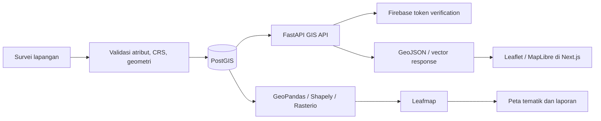

# 04. GIS ARCHITECTURE – LEAFMAP
## Green Garden Residence – Integrated Community Management System

**Lingkup Wilayah:** RT 06 RW 01, Perum Green Garden Residence, Desa Cipicung, Kecamatan Banyuresmi, Kabupaten Garut

## 1. Tujuan

Modul GGR-GIS menyediakan inventarisasi spasial lingkungan, peta interaktif, pencatatan kondisi prasarana, lokasi pengaduan, dan analisis pendukung keputusan. GIS adalah alat pengelolaan informasi spasial, bukan pengganti survei teknik atau penetapan batas kadaster.

## 2. Arsitektur

### Peran komponen
- PostGIS: penyimpanan geometri, indeks spasial, transformasi, kueri.
- FastAPI: otorisasi, validasi, endpoint, dan pemrosesan.
- Leafmap: eksplorasi dan visualisasi berbasis Python.
- Leaflet/MapLibre: peta interaktif di browser.
- GeoPandas/Shapely: pemrosesan vektor.
- Rasterio: data raster jika tersedia.
- Basemap: OpenStreetMap atau penyedia lain dengan atribusi dan syarat penggunaan yang sesuai.

## 3. Layer Data

| Layer | Geometri | Atribut inti |
|---|---|---|
| Batas lingkungan | Polygon | ID, nama, sumber, tanggal verifikasi |
| Blok | Polygon | kode blok, nama |
| Rumah | Point/Polygon | houseId, kode unit, status data |
| Jalan | LineString | nama, jenis permukaan, lebar, kondisi |
| Drainase | LineString | jenis, material, dimensi, kondisi |
| Fasilitas | Point/Polygon | nama, jenis, kondisi |
| Lampu jalan | Point | ID, jenis, kondisi, inspeksi |
| Titik sampah | Point | kategori, jadwal, kondisi |
| Aset | Point/Line/Polygon | ID aset, jenis, kondisi |
| Pengaduan | Point | ticketId, kategori, status |
| Kejadian | Point/Polygon | tipe, waktu, dampak |
| Inspeksi | Point | waktu, petugas, hasil |

Data publik tidak menampilkan nama warga, nomor telepon, NIK, nomor KK, atau rincian privat.

## 4. Sistem Referensi Koordinat

- EPSG:4326 digunakan untuk GeoJSON dan pertukaran koordinat geografis.
- EPSG:32748 digunakan untuk analisis metrik di kawasan Garut setelah zona dan datum diverifikasi.
- Setiap data harus menyatakan CRS secara eksplisit.
- Koordinat dari ponsel tidak boleh dianggap sebagai batas persil presisi.
- Transformasi CRS dilakukan melalui pustaka GIS atau PostGIS, bukan dengan mengubah angka koordinat secara manual.

## 5. Spesifikasi Survei Lapangan

### 5.1 Metadata wajib
- `feature_id`
- `feature_type`
- `survey_date`
- `survey_time`
- `surveyor_id`
- `source_method`
- `crs`
- `accuracy_m`
- `condition`
- `verification_status`
- `photo_reference` bila relevan

### 5.2 Metode
1. Persiapkan formulir dan kode objek.
2. Tentukan metode pengukuran sesuai tujuan.
3. Ambil titik/garis/poligon dan foto pendukung.
4. Catat akurasi dan kondisi lapangan.
5. Validasi topologi dan atribut.
6. Tinjau silang dengan citra/peta dasar yang sah.
7. Lakukan verifikasi oleh koordinator.
8. Publikasikan hanya layer yang telah disetujui.

GPS ponsel memadai untuk inventarisasi indikatif. Pengukuran batas, elevasi rinci, dan pekerjaan teknik yang membutuhkan ketelitian harus menggunakan metode survei yang sesuai.

## 6. Prosedur Kualitas Data GIS

- Pemeriksaan geometri kosong/invalid.
- Pemeriksaan duplikasi ID.
- Pemeriksaan koordinat di luar area kerja.
- Pemeriksaan CRS.
- Pemeriksaan atribut wajib.
- Pemeriksaan gap/overlap untuk polygon yang memang harus bersambung.
- Pemeriksaan konektivitas untuk jaringan jalan/drainase bila diperlukan.
- Pencatatan sumber dan tingkat keyakinan data.

## 7. Analisis Spasial

### 7.1 Inventarisasi
Hitung jumlah aset per kategori, kondisi, blok, dan periode inspeksi.

### 7.2 Kedekatan
Analisis jarak rumah ke fasilitas, titik layanan, atau lokasi risiko menggunakan CRS metrik yang sesuai.

### 7.3 Pengaduan
Pemetaan sebaran tiket, pengelompokan lokasi, tren waktu, dan konsentrasi masalah.

### 7.4 Prioritas pemeliharaan
Skor dapat dibangun dari:
- tingkat kerusakan;
- dampak terhadap keselamatan/layanan;
- jumlah laporan;
- urgensi;
- biaya indikatif;
- kemudahan akses.

Bobot skor harus disepakati dan tidak boleh diperlakukan sebagai hasil rekayasa objektif tanpa validasi.

### 7.5 Drainase dan genangan
Pemetaan saluran, dimensi terukur, titik sumbatan, dan lokasi genangan dapat menjadi inventaris awal. Analisis kapasitas hidraulik memerlukan data topografi, penampang, kemiringan, kondisi batas, hujan, dan metode pemodelan yang sesuai. Leafmap sendiri bukan solver hidraulika.

## 8. Desain API GIS

| Method | Path | Kegunaan |
|---|---|---|
| GET | `/v1/layers` | Daftar layer sesuai akses |
| GET | `/v1/layers/{id}/features` | Fitur dalam bbox |
| GET | `/v1/features/{id}` | Detail fitur |
| POST | `/v1/features` | Membuat fitur |
| PATCH | `/v1/features/{id}` | Memutakhirkan fitur |
| POST | `/v1/analysis/nearest` | Analisis kedekatan |
| POST | `/v1/analysis/summary` | Ringkasan spasial |

Semua operasi privat memerlukan Firebase ID token yang diverifikasi. Otorisasi diperiksa berdasarkan layer, operasi, wilayah, dan peran.

## 9. Pengambilan Data Peta

Parameter yang disarankan:
- `bbox=minLon,minLat,maxLon,maxLat`
- `limit` dengan batas maksimum
- `cursor` untuk pagination
- `fields` yang diizinkan
- `updatedSince` untuk sinkronisasi inkremental

Jangan mengirim semua fitur dalam satu respons. Terapkan generalisasi geometri pada zoom kecil dan vector tiles bila jumlah fitur membesar.

## 10. Keamanan GIS

- Jangan mengekspos koneksi PostGIS ke browser.
- Jangan mengirim PII pada GeoJSON publik.
- Verifikasi token pada setiap request.
- Terapkan role dan izin per layer.
- Validasi geometri dan ukuran payload.
- Batasi query spasial yang mahal.
- Catat perubahan geometri dan atribut.
- Simpan foto di Drive privat dan referensikan melalui ID internal.
- Terapkan audit untuk ekspor data.

## 11. Integrasi Leafmap

Leafmap dapat dipakai pada notebook atau layanan pemrosesan Python untuk:
- membaca GeoJSON/GeoPackage;
- menggabungkan layer;
- membuat peta tematik;
- memeriksa data;
- menyiapkan output untuk laporan.

Peta produksi browser tetap memakai Leaflet/MapLibre. Jika Leafmap dipakai untuk proses terjadwal, jalankan pada worker/service yang sesuai, bukan pada request interaktif yang harus merespons cepat.

## 12. Keluaran GIS

- Peta inventaris rumah dan fasilitas.
- Peta jalan dan drainase.
- Peta kondisi aset.
- Peta pengaduan dan kejadian.
- Peta prioritas inspeksi/pemeliharaan.
- Ekspor GeoJSON/CSV sesuai hak akses.
- Laporan kualitas data dan metadata survei.

## 13. Tahapan Implementasi

1. Penetapan kode objek dan kamus data.
2. Survei batas indikatif, rumah, jalan, fasilitas.
3. Pembuatan PostGIS dan skema.
4. Import dan validasi.
5. FastAPI dan verifikasi token.
6. Integrasi Leaflet/MapLibre ke Next.js.
7. Penerapan layer dan filter.
8. Analisis Leafmap/GeoPandas.
9. UAT dan SOP pemutakhiran.

## 14. Kriteria Penerimaan

- CRS dan metadata tiap layer jelas.
- ID fitur unik.
- Geometri valid.
- Atribut wajib lengkap sesuai target.
- Layer sensitif tidak terlihat oleh pengguna umum.
- Peta dapat difilter dan digunakan pada ponsel.
- API menerapkan autentikasi, otorisasi, pagination, dan batas hasil.
- Data dapat diekspor dan dipulihkan.
