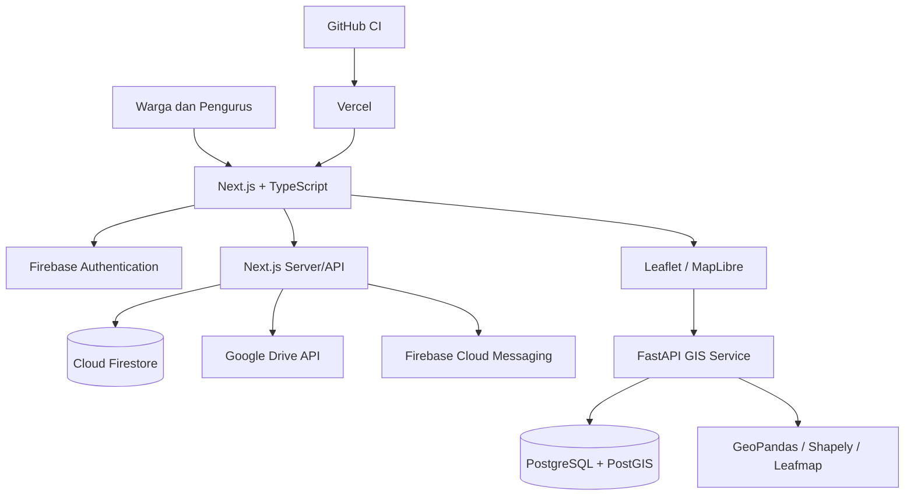

# 01. SYSTEM ARCHITECTURE DOCUMENT (SAD)
## Green Garden Residence – Integrated Community Management System

**Versi:** 1.0  
**Status:** Rancangan teknis untuk validasi  
**Lingkup:** RT 06 RW 06, Perum Green Garden Residence, Desa Cipicung, Kecamatan Banyuresmi, Kabupaten Garut

---

## 1. Tujuan Dokumen

Dokumen ini menetapkan arsitektur konseptual dan teknis GGR-ICMS sebagai acuan bagi pengembang, pengurus, administrator, dan pengelola data. SAD menjelaskan komponen, batas sistem, aliran informasi, keputusan teknologi, kebutuhan kualitas, serta risiko arsitektur. Dokumen ini bukan bukti bahwa sistem telah dibangun atau layanan pihak ketiga telah dikonfigurasi.

## 2. Sasaran Arsitektur

1. Mengintegrasikan layanan warga, administrasi, keuangan, pengaduan, komunikasi, aset, dan GIS.
2. Menjaga pemisahan data operasional, data spasial, dan arsip dokumen.
3. Menerapkan autentikasi dan otorisasi pada sisi server.
4. Mendukung penggunaan ponsel dan desktop.
5. Memungkinkan pengembangan bertahap tanpa mengganti keseluruhan sistem.
6. Memastikan data dapat diaudit, diekspor, dicadangkan, dan dipulihkan.

## 3. Konteks Sistem dan Batas

### 3.1 Aktor

| Aktor | Interaksi |
|---|---|
| Warga | Melihat informasi, mengajukan layanan, mengirim pengaduan, melihat data yang diizinkan |
| Ketua RT | Memantau, menyetujui, mengumumkan, dan mengevaluasi |
| Sekretaris | Mengelola data warga, permohonan, surat, dan arsip |
| Bendahara | Mencatat dan merekonsiliasi transaksi |
| Petugas keamanan | Mencatat kejadian dan patroli sesuai kewenangan |
| Koordinator prasarana/GIS | Memutakhirkan inventaris dan data spasial |
| Administrator | Mengelola konfigurasi teknis dan akun |
| Auditor internal | Memeriksa catatan sesuai mandat |

### 3.2 Batas Sistem

GGR-ICMS tidak menggantikan sistem administrasi kependudukan pemerintah, sistem perbankan, sistem kadaster, atau perangkat lunak analisis hidrologi/hidraulika khusus. Dokumen yang diterbitkan sistem merupakan dokumen internal lingkungan sesuai kewenangan organisasi dan tidak boleh diklaim sebagai dokumen pemerintah.

## 4. Prinsip Desain

- Security and privacy by design.
- Least privilege dan deny-by-default.
- Satu sumber utama untuk setiap domain data.
- API-first dan kontrak antarlayanan terdokumentasi.
- Minimasi data pribadi.
- Audit trail untuk perubahan kritis.
- Penggunaan format terbuka.
- Progressive delivery dan pengujian sebelum rilis.
- Human-in-the-loop untuk persetujuan administrasi dan keuangan.

## 5. Arsitektur Konseptual

### 5.1 Keputusan Teknologi

| Lapisan | Teknologi | Keputusan |
|---|---|---|
| Web | Next.js, TypeScript | Aplikasi utama |
| Auth | Firebase Authentication | Identitas dan token |
| Operasional | Cloud Firestore | Profil, permohonan, transaksi tahap awal, pengumuman |
| Arsip | Google Drive API | Berkas privat |
| GIS API | FastAPI | API spasial dan proses Python |
| Spatial DB | PostgreSQL + PostGIS | Sumber utama geometri |
| GIS processing | Leafmap, GeoPandas, Shapely, Rasterio | Analisis dan pemrosesan |
| Peta browser | Leaflet atau MapLibre | Visualisasi interaktif |
| Source control | GitHub | Repositori dan review |
| Hosting web | Vercel | Build dan hosting Next.js |

Leafmap adalah alat Python untuk analisis/visualisasi GIS. Untuk peta interaktif di browser Next.js gunakan Leaflet atau MapLibre. Layanan FastAPI ditempatkan pada lingkungan yang mendukung Python dan dependensi geospasial.

## 6. Penetapan Sumber Utama Data

| Data | Sumber utama | Kunci penghubung |
|---|---|---|
| Akun | Firebase Auth | `uid` |
| Profil warga/rumah tangga | Firestore | `residentId`, `houseId` |
| Surat dan permohonan | Firestore | `requestId` |
| Transaksi tahap awal | Firestore | `transactionId` |
| Geometri rumah/jalan/drainase | PostGIS | `houseId`, `spatialId` |
| Dokumen | Google Drive | `driveFileId` |
| Audit aplikasi | Firestore atau penyimpanan audit terpisah | `eventId` |

Data pribadi tidak boleh disalin ke atribut layer peta kecuali ada kebutuhan yang sah dan akses terbatas. Peta umum cukup menampilkan kode unit dan atribut non-sensitif.

## 7. Pola Integrasi dan Aliran Permintaan

1. Pengguna mengakses aplikasi melalui HTTPS.
2. Firebase Authentication memverifikasi identitas dan menerbitkan ID token.
3. Frontend mengirim token ke backend melalui `Authorization: Bearer`.
4. Backend memverifikasi token, status akun, peran, dan hak akses objek.
5. Backend menjalankan operasi pada Firestore, PostGIS, atau Drive.
6. Perubahan kritis dicatat pada audit log.
7. Respons mengandung data minimum yang diperlukan.

Pemeriksaan role pada antarmuka hanya untuk pengalaman pengguna; otorisasi sesungguhnya wajib dilakukan di backend. Firebase Admin SDK melewati Firestore Security Rules, sehingga pemeriksaan akses pada backend tetap wajib.

## 8. Topologi Lingkungan

| Lingkungan | Penggunaan | Ketentuan |
|---|---|---|
| Local | Pengembangan | Data sintetis, emulator jika tersedia |
| Development | Integrasi fitur | Proyek dan kredensial terpisah |
| Staging | UAT/regresi | Menyerupai produksi |
| Production | Operasional | Backup, monitoring, akses terbatas |

Pisahkan proyek Firebase, database, folder Drive, domain, dan secret antarl ingkungan. Jangan menyalin data warga produksi ke development.

## 9. Kebutuhan Kualitas Arsitektur

| Atribut | Target awal | Cara verifikasi |
|---|---|---|
| Availability | 99,5% per bulan sebagai sasaran awal | Monitoring uptime |
| Kinerja | P95 API ringan < 1 detik pada beban uji yang disepakati | Load test |
| Responsif | Ponsel, tablet, desktop | Uji perangkat |
| Keamanan | RBAC, token verification, audit, secret management | Security test |
| Portabilitas | Ekspor CSV/JSON/GeoJSON | Uji ekspor |
| Pemulihan | RPO/RTO disepakati dan diuji | Restore exercise |
| Maintainability | Type checking, lint, test, dokumentasi | CI pipeline |

Target tersebut perlu dikalibrasi berdasarkan anggaran, paket layanan, jumlah pengguna, dan hasil pengukuran.

## 10. Keputusan Arsitektur yang Harus Dicatat (ADR)

Setiap keputusan besar dicatat dalam format:
- ID dan judul.
- Status (proposed/accepted/deprecated).
- Konteks dan masalah.
- Opsi yang dipertimbangkan.
- Keputusan.
- Konsekuensi dan risiko.
- Tanggal dan penanggung jawab.

ADR awal:
1. Firestore untuk operasional, PostGIS untuk geometri.
2. Leaflet/MapLibre untuk browser; Leafmap untuk Python GIS.
3. Drive untuk berkas, metadata di Firestore.
4. FastAPI GIS dipisahkan dari runtime Next.js.
5. Semua operasi sensitif melalui backend.

## 11. Risiko dan Mitigasi

| Risiko | Mitigasi |
|---|---|
| Duplikasi data antarplatform | Tetapkan source of truth dan kunci penghubung |
| Kebocoran PII melalui GIS | Layer minim data dan endpoint terotorisasi |
| Ketergantungan vendor | Ekspor berkala dan format terbuka |
| Batas runtime serverless | Pisahkan layanan GIS dan uji beban |
| Peran terlalu luas | RBAC rinci dan review berkala |
| Data lokasi tidak akurat | Metadata sumber/akurasi dan verifikasi lapangan |

## 12. Kriteria Persetujuan SAD

- Batas sistem dan aktor disepakati.
- Sumber utama setiap domain data ditetapkan.
- Diagram arsitektur disetujui.
- Mekanisme token dan otorisasi disepakati.
- Lingkungan deployment dan backup ditentukan.
- Risiko utama memiliki pemilik dan mitigasi.
- ADR dicatat dan ditinjau sebelum implementasi.

## 13. Referensi Teknis

Gunakan dokumentasi resmi versi yang berlaku saat implementasi: Next.js, Firebase, Google Drive API, PostgreSQL, PostGIS, FastAPI, Leafmap, Leaflet/MapLibre, GitHub, dan Vercel. Standar arsitektur dan keamanan yang dapat ditelaah antara lain ISO/IEC/IEEE 42010, ISO/IEC 27001, serta ISO/IEC 25010.
